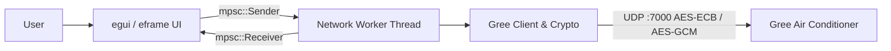

# Gree Remote App


A native, 100% Rust desktop remote control for Gree Smart Air Conditioners over the local network, built with `egui` / `eframe`.

## Table of Contents

- [About](#about)
- [Features](#features)
- [Tech Stack](#tech-stack)
- [Architecture](#architecture)
- [Project Structure](#project-structure)
- [Getting Started](#getting-started)
- [Useful Commands](#useful-commands)
- [Troubleshooting](#troubleshooting)
- [Roadmap](#roadmap)
- [Contributing](#contributing)
- [Acknowledgments](#acknowledgments)
- [License](#license)

## About

Gree Smart Air Conditioners expose a local UDP JSON protocol on port `7000`, allowing full control without relying on cloud servers. **Gree Remote App** provides a fast, lightweight Linux desktop interface (with zero C++ or OpenSSL dependencies) to discover, bind, monitor, and control Gree units directly on your LAN.

## Features

| Feature | Description |
|---|---|
| Local discovery | Finds devices via UDP broadcast, automatic `/24` unicast subnet sweep, or manual IP entry |
| Dual encryption | Supports both `AES-128-ECB` and `AES-128-GCM` with automatic fallback during device binding |
| Full climate control | Power toggle, target temperature (`16–30 °C`), mode (`Auto`, `Cool`, `Dry`, `Fan`, `Heat`), and fan speed |
| Airflow & extras | Vertical/horizontal swing, LED display light, Turbo, Quiet, Sleep, X-Fan, Health, Saving, Fresh Air, and 8 °C guard |
| Live sensor & polling | Displays the unit's internal ambient temperature sensor (`TemSen`) with optional 10-second auto-refresh |
| CLI scan mode | Includes a `--scan` flag to discover, bind, and print device status directly in the terminal |

## Tech Stack

| Layer | Technology |
|---|---|
| Language | Rust (Edition 2024, tested with `rustc 1.99.1`) |
| GUI Framework | `eframe` / `egui` `0.31` |
| Cryptography | `aes` `0.8`, `ecb` `0.1`, `aes-gcm` `0.10`, `base64` `0.22` (pure Rust) |
| Serialization | `serde` `1`, `serde_json` `1` |
| Networking | `std::net::UdpSocket`, `if-addrs` `0.13` |

## Architecture

The UI runs on the main thread while all UDP discovery, binding, status polling, and control commands execute on a dedicated background worker thread communicating through `std::sync::mpsc` channels so the interface stays responsive.



## Project Structure

```text
src/
├── main.rs            # Entry point (eframe native window & --scan CLI mode)
├── app.rs             # egui layout, state management, and background worker
├── ui/
│   ├── theme.rs       # Dark theme visuals and dynamic mode accent palette
│   ├── icons.rs       # 100% vector icon library drawn with egui::Painter
│   └── widgets.rs     # Circular thermostat dial, segmented bars, and toggle tiles
└── gree/
    ├── crypto.rs      # AES-128-ECB & AES-128-GCM encryption + lenient Base64 decoding
    ├── protocol.rs    # Gree JSON envelopes, enums, and status parsing
    ├── client.rs      # Broadcast/unicast discovery, bind fallback, status, and commands
    └── storage.rs     # Local JSON cache (~/.config/gree-remote-app/devices.json)
```

## Getting Started

> Setup last verified: 2026-11 · Linux (x86_64) + `rustc 1.99.1` / `cargo 1.99.1`

### Prerequisites

- Rust toolchain (`rustc` and `cargo`) supporting **Edition 2024** (`rustc >= 1.85`)
- A Gree-compatible air conditioner connected to the same local network (UDP port `7000`)

### Installation & Run

**Pre-built binaries (GitHub Releases):** Download the latest release for **Linux** (`.tar.gz`), **Windows** (`.exe`), or **macOS** (`.dmg`) from the [Releases](https://github.com/rafaelwt/gree-remote-app/releases) page.

**From source:**

```bash
git clone https://github.com/rafaelwt/gree-remote-app.git
cd gree-remote-app
cargo run --release
```

**Install on Linux / KDE Plasma (with desktop launcher & icon):**

```bash
./packaging/linux/install-user.sh
```

**Install on Arch Linux / CachyOS (`PKGBUILD`):**

```bash
cd packaging/arch
makepkg -si
```

### Verify

- Launch the desktop app with `cargo run` — it will automatically scan your local subnet and display discovered units.
- Or verify connectivity from the terminal without opening a window:

```bash
cargo run -- --scan
```

## Useful Commands

| Command | Description |
|---|---|
| `cargo run` | Build and launch the desktop GUI in debug mode |
| `cargo run --release` | Build and launch the optimized desktop GUI |
| `cargo run -- --scan` | Discover, bind, and print live AC status in the terminal |
| `cargo run -- --scan --ip 192.168.1.100` | Probe a specific AC IP address directly |
| `cargo test` | Run unit tests (ECB/GCM round-trips and Base64 decoding) |

## Troubleshooting

#### No devices found during automatic scan
- **Symptom:** The app finishes scanning and reports no Gree devices found.
- **Cause:** Some routers block UDP broadcasts between Ethernet and Wi-Fi, host firewalls drop broadcast replies, or the AC is on a different subnet.
- **Solution:** Enter the AC's IP address directly in the top **IP** input field and click **Conectar** (or test with `cargo run -- --scan --ip <device-ip>`).

#### `Bind failed` or timeout on newer firmware (`V2.0.0`+)
- **Symptom:** The unit responds to `scan` but fails or times out during `bind`.
- **Cause:** Newer Gree firmwares require `AES-128-GCM` for binding even when `scan` replies in `AES-128-ECB`.
- **Solution:** The client automatically falls back from ECB to GCM on timeout. Ensure UDP port `7000` is reachable and retry **Escanear red**.

## Roadmap

- Support Fahrenheit (`TemUn` / `TemRec`) display and control
- System tray integration and quick toggle menu
- Device schedule / timer management (`setT`)
- Cross-platform release packaging (`.exe`, `.dmg`, Arch `PKGBUILD` / `AppImage`)

## Contributing

Contributions are welcome:

1. Fork the repository.
2. Create a feature branch (`git checkout -b feat/my-feature`).
3. Make your changes and verify with `cargo test` and `cargo build`.
4. Open a Pull Request describing the change.

## Acknowledgments

- Protocol specification and reverse-engineering reference from [tomikaa87/gree-remote](https://github.com/tomikaa87/gree-remote).
- GUI powered by [emilk/egui](https://github.com/emilk/egui).

## License

This project is licensed under the MIT License — see the [LICENSE](LICENSE) file for details.
